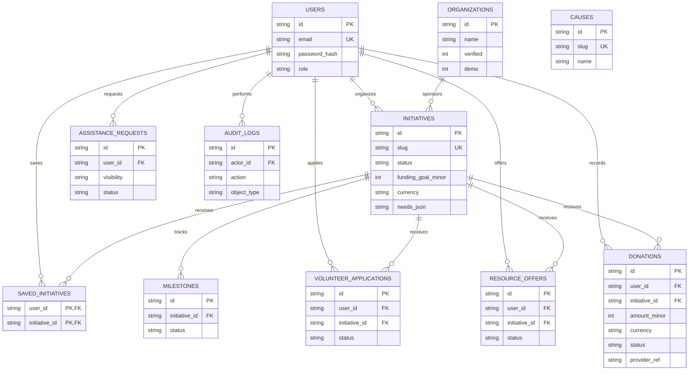

# Data model and relationships

This local MVP uses SQLite to make the application self-contained. Table shapes and relationships are intended to support migration to PostgreSQL; financial amounts use integer minor units and currency codes. Schema initialization is implemented in `lib/db.ts`.

The `causes` table is seeded independently; the current initiative cause is stored as its displayed cause name rather than a foreign key. This is a migration gap to resolve when moving to PostgreSQL. Assistance review notes are stored as audit details and are not shown to requesters. Private document storage, organization membership, notification records, refunds, and provider webhook events are not implemented in the local MVP.
